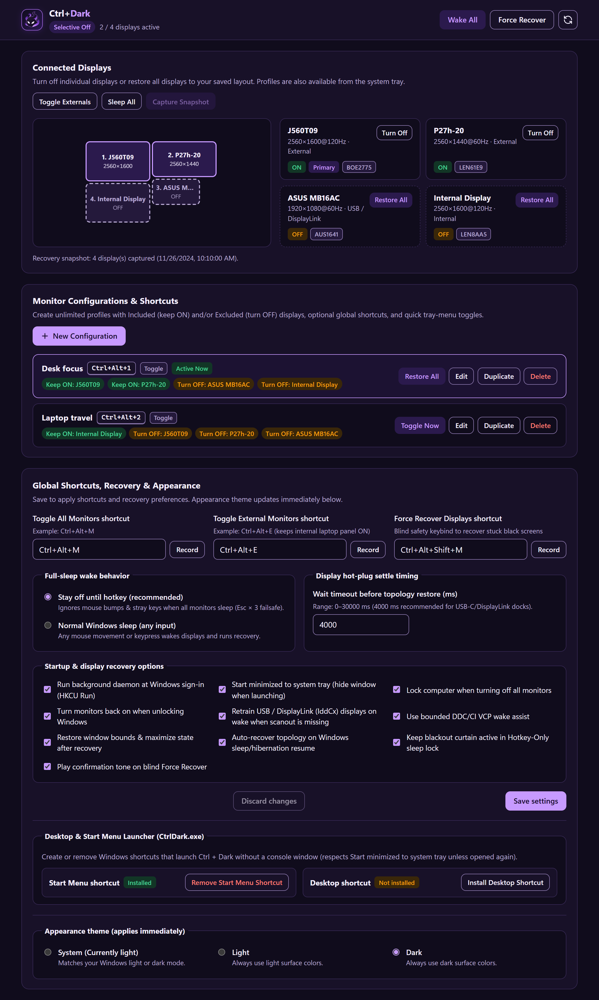
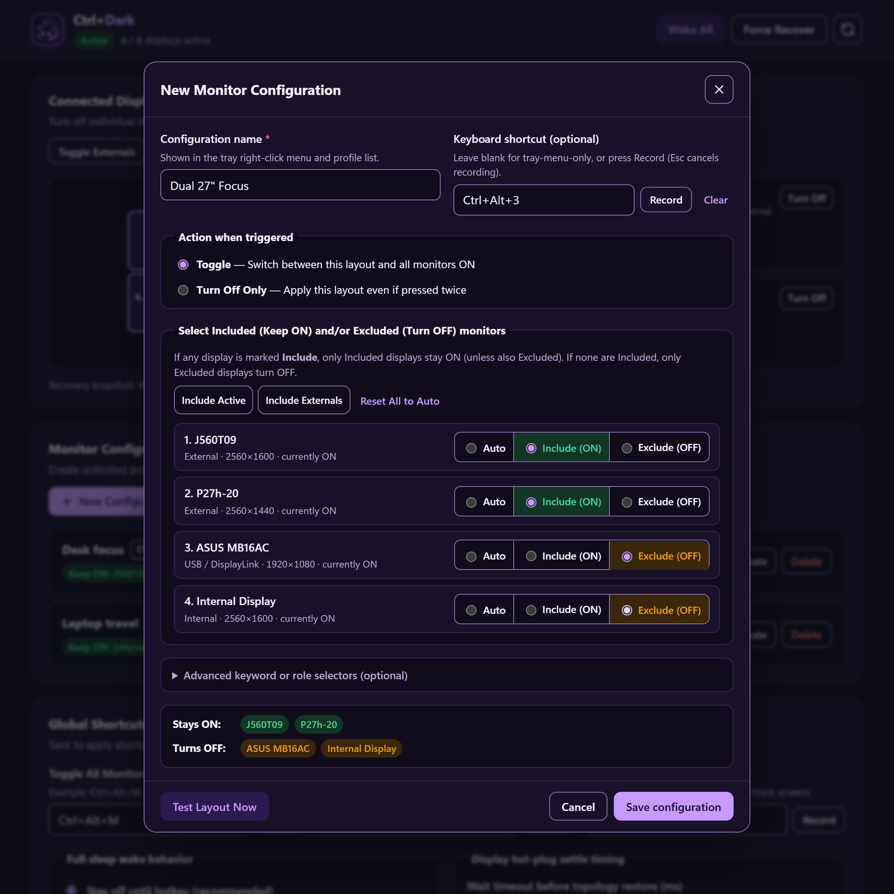
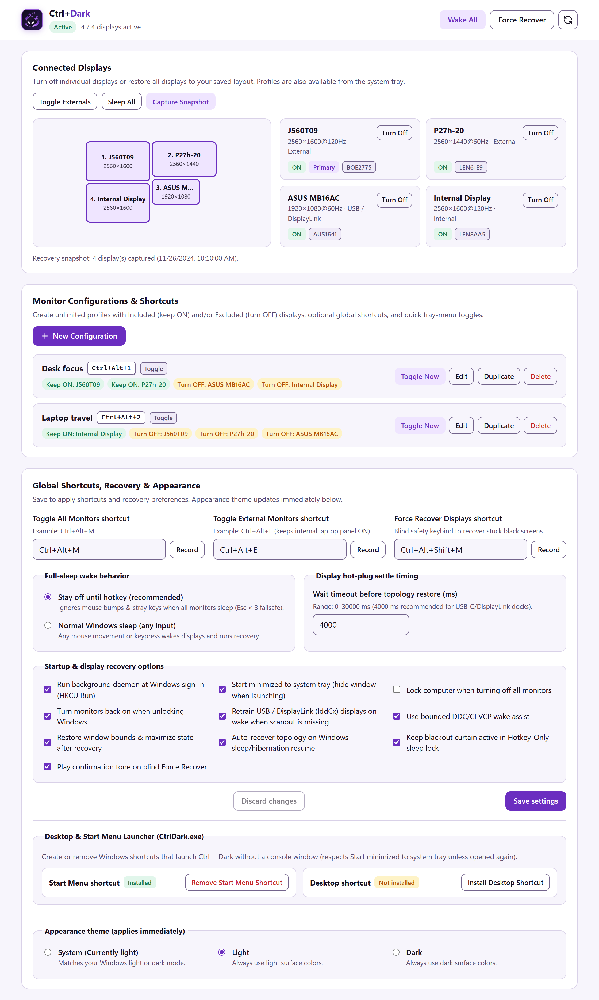
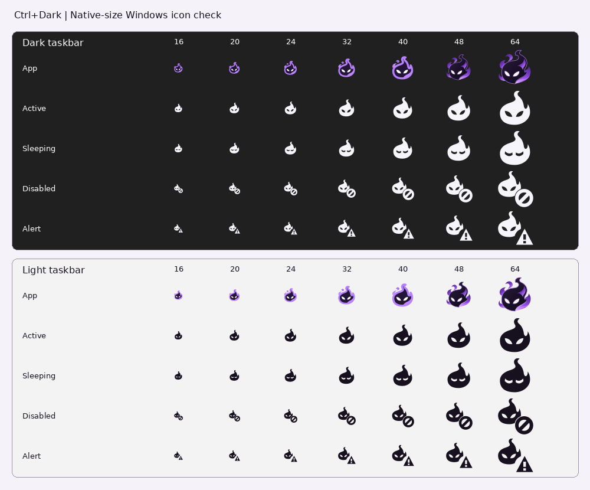

<p align="center">
  
</p>

<h1 align="center">Ctrl + Dark</h1>

<p align="center">
  <br>
  Turn off selected or all Windows monitors with a hotkey and restore display layouts reliably.
</p>

Ctrl + Dark (`monitor-toggle`) is a native Windows 10/11 utility that sleeps all monitors, turns off only external monitors, or toggles custom monitor combinations while protecting against black screens and lost window positions.

<p align="center">
  <br>
  <em>Dark Control Panel showing Selective Off (2/4 displays active), custom profiles, and session lock/unlock toggles.</em>
</p>

## Where to find each task

| If you want to | Go to |
|---|---|
| Check requirements and executables | [Before you start](#before-you-start) |
| Build from source and run the first setup | [Build and first launch](#build-and-first-launch) |
| Use hotkeys, the Control Panel, and custom profiles | [Everyday use](#everyday-use) |
| Choose wake lock mode and keep data local | [Wake mode and security](#wake-mode-and-security) |
| Look up every setting and default value | [Settings reference](#settings-reference) |
| Run commands from PowerShell | [CLI reference](#cli-reference) |
| Fix common mistakes or recovery issues | [Troubleshooting](#troubleshooting) |
| Inspect brand artwork or run CI checks | [Brand assets and developer checks](#brand-assets-and-developer-checks) |

**Reading paths.** First-time users read [Before you start](#before-you-start) through [Wake mode and security](#wake-mode-and-security) in order. Returning users use the table above to jump to a setting, CLI command, or fix.

---

## Before you start

### What you need

- **Operating system:** Windows 10 or Windows 11.
- **Build toolchain:** Rust MSVC toolchain, Visual Studio C++ Build Tools, and Windows SDK (`rc.exe` compiles [assets/icons/CtrlDark.ico](assets/icons/CtrlDark.ico) into every binary via [build.rs](build.rs)).
- **Control Panel runtime:** Microsoft Edge WebView2 Runtime for native window rendering. If WebView2 initialization fails, the launcher opens the Control Panel in your default browser.
- **Browser test suite (optional):** Node.js 22+ and Microsoft Edge or Chromium.

### Application executables

Keep all four executables together in the same folder (`target\release\` after a release build).

| Executable | Role |
|---|---|
| `CtrlDark.exe` | Windowless desktop launcher. Respects `start_minimized_to_tray` on cold launch and opens the Control Panel when launched again while running. |
| `monitor-toggled.exe` | Background tray, global hotkey, hot-plug monitor, loopback HTTP server, Named Pipe IPC, and display recovery daemon. |
| `monitor-toggle-ui.exe` | On-demand WebView2 Control Panel window. Exits completely when closed so no WebView memory remains in the background. |
| `monitor-toggle.exe` | Console CLI controller communicating with `monitor-toggled.exe` over `\\.\pipe\monitor-toggle-v1`, plus standalone recovery and benchmarking. |

---

## Build and first launch

To build Ctrl + Dark, capture your baseline display layout, and start the tray daemon, open PowerShell and run the following commands.

1. Clone the repository and move into the project folder:

   ```powershell
   git clone https://github.com/dvortsis/ctrl-dark.git
   cd ctrl-dark
   ```

   **Result:** The source files and brand assets download into `ctrl-dark`.

2. Build the release binaries with the locked dependency graph:

   ```powershell
   cargo build --release --locked
   ```

   **Result:** Cargo creates `CtrlDark.exe`, `monitor-toggled.exe`, `monitor-toggle-ui.exe`, and `monitor-toggle.exe` inside `target\release\`.

3. Verify your connected monitors while every screen is powered on and active:

   ```powershell
   .\target\release\monitor-toggle.exe monitors
   ```

   **Result:** A table lists each connected display's name, role (`Internal`, `External`, or `UsbIndirect`), GDI device, state, resolution, position, and `stable_key`.

4. Save the healthy multi-monitor topology as your rollback baseline:

   ```powershell
   .\target\release\monitor-toggle.exe snapshot
   ```

   **Result:** Ctrl + Dark saves `%LOCALAPPDATA%\monitor-toggle\last-known-good.json` and reports the captured display count.

5. Optional: install Start Menu and Desktop shortcuts (`Ctrl + Dark.lnk`) plus Windows sign-in autostart:

   ```powershell
   .\target\release\monitor-toggle.exe shortcut install --start-menu --desktop
   .\target\release\monitor-toggle.exe autostart enable
   ```

   **Result:** Shortcuts target `CtrlDark.exe`, and `HKCU\Software\Microsoft\Windows\CurrentVersion\Run\CtrlDark` starts `CtrlDark.exe --autostart` at sign-in.

6. Launch Ctrl + Dark:

   ```powershell
   .\target\release\CtrlDark.exe --open
   ```

   **Result:** The background tray daemon starts, shows the shadow-flame icon in your Windows notification area, and opens the **Ctrl+Dark** Control Panel window. Next time you launch `CtrlDark.exe`, it starts minimized to the tray when `start_minimized_to_tray = true`.

---

## Everyday use

### Default hotkeys

| Hotkey | Scope / Behavior |
|---|---|
| `Ctrl+Alt+M` | Toggle **all** monitors off or wake and recover all monitors. |
| `Ctrl+Alt+E` | Toggle **external** monitors only (keeps your internal laptop display active). |
| `Ctrl+Alt+D` | Toggle the starter custom configuration **Only P27h-20 & J560T09** (`include = ["P27h-20", "J560T09"]`). |
| `Ctrl+Alt+Shift+M` | **Force Recover Displays** from any state, even when screens are black, including external link bounces. |
| `Esc` × 3 *(within 2 s)* | Emergency hardware unlock while **Stay off until hotkey** (`hotkey_only`) lock mode is armed. |

### Using the Control Panel

Left-click the tray icon, right-click the tray icon and choose **Open Control Panel...**, or launch `CtrlDark.exe` while the daemon is running to open the Control Panel.

- **Connected Displays:** Inspect active, off, and temporarily unplugged displays on the interactive 2D layout map. Select any monitor tile on the map or **Turn Off** on a monitor card to deactivate a single display, or select **Restore All** to wake displays to the saved snapshot.
- **Quick layout actions:** Use **Toggle Externals**, **Sleep All**, **Capture Snapshot**, **Wake All**, or **Force Recover** in the header and display toolbar.
- **Monitor Configurations & Shortcuts:** Create unlimited profiles selecting **Include (ON)**, **Exclude (OFF)**, or **Auto** per monitor, with optional global shortcuts or blank shortcuts for tray-only toggling.
- **Global Shortcuts, Recovery & Appearance:** Press **Record** beside any shortcut box to capture a keybind (`Esc` cancels recording), adjust recovery timeouts and independent session lock/unlock toggles, manage **Desktop & Start Menu Launcher (`CtrlDark.exe`)** shortcuts, or switch between **System**, **Light**, and **Dark** themes immediately.
- **Draft safety:** Refreshing polls do not overwrite unsaved form edits. Select **Discard changes** to reload saved values, or **Save settings** to validate and apply changes.

> [!NOTE]
> **Worked example: Creating a custom two-monitor focus profile**
>
> 1. Under **Monitor Configurations & Shortcuts**, select **New Configuration**.
> 2. Enter **Configuration name** as `Desk Focus`.
> 3. Select **Record** beside **Keyboard shortcut (optional)** and press `Ctrl+Alt+2`.
> 4. Mark your two desk monitors as **Include (ON)** (leaving other displays on **Auto** so they turn off), verify the live **Stays ON** / **Turns OFF** preview, and select **Test Layout Now** if you want to preview before saving.
> 5. Select **Save configuration**.
>    **Result:** Ctrl + Dark binds `Ctrl+Alt+2` immediately and adds **Desk Focus** to the system tray menu with an active checkmark whenever that layout is engaged.

<p align="center">
  <br>
  <em>Configuration Builder dialog with live Stays ON and Turns OFF outcome previews.</em>
</p>

<p align="center">
  <br>
  <em>Light theme Control Panel showing all four displays active.</em>
</p>

### System tray & physical monitor power buttons

- **Taskbar-adaptive tray icons:** The daemon reads `SystemUsesLightTheme` and responds to `WM_SETTINGCHANGE`. Dark taskbars show a light-outlined icon (`dark-active.ico`), light taskbars show a dark-outlined icon (`light-active.ico`), and sleep/selective-off states show the full-color violet **Ctrl + Dark** emblem (`CtrlDark.ico`).
- **Additive selective off:** Turning off one display while another display is already off keeps existing off displays disabled instead of waking them back up.
- **Physical power-button protection:** When you power an external monitor off or on via its hardware button while in `selective_off` mode, Windows may temporarily reactivate another disabled display (such as an internal laptop screen) from its topology database. Ctrl + Dark detects the hot-plug event via `WM_DEVICECHANGE` and `WM_TIMER` (`500 ms` settle window, `3 s` enforcement window) and re-disables the intended display automatically.
- **Last-screen safety guard:** If disconnecting external monitors leaves zero other active displays on the system, Ctrl + Dark keeps the last remaining screen active so you never hit a black screen when undocking a laptop.

---

## Wake mode and security

### Choosing a full-sleep wake mode

Select the full-sleep mode in the Control Panel under **Full-sleep wake behavior**, from the tray menu item **Stay Off Until Hotkey (Ignore Mouse Bumps)**, or in `config.toml` under `wake_mode`.

| Option | When to use it |
|---|---|
| `hotkey_only` **(recommended)** | Blocks accidental mouse bumps, desk vibrations, and stray keypresses from waking sleeping monitors. Press your toggle/recover hotkey or press `Esc` three times within `2 s` to unlock. |
| `any_input` | Standard Windows DPMS monitor sleep. Useful when you want any mouse move or keypress to wake and recover displays automatically. |

### Locking and unlocking Windows

Configure Windows lock and unlock automation as two independent options in the Control Panel, the system tray right-click menu, or `config.toml`:

- **Lock computer when turning off monitors** (`lock_workstation_on_sleep`): Calls Windows `LockWorkStation` when turning off monitors via full sleep or selective-off profiles and toggles (automatic hot-plug re-disables do not re-lock). Input locking (`hotkey_only`) stands down during session lock so the Windows sign-in screen accepts your password or PIN.
- **Turn monitors back on when unlocking Windows** (`wake_on_session_unlock`): Subscribes to Windows session unlock notifications (`WTS_SESSION_UNLOCK`) and wakes or restores all displays with full topology recovery when you unlock Windows from full sleep or `SelectiveOff`. While locked, display change and wake recovery handlers stay paused so background lock-screen events cannot disrupt the sign-in screen.

Both toggles act independently. Enable either option alone or together from **Startup & display recovery options** or the tray items **Lock Computer When Turning Off Monitors** and **Turn Monitors On When Unlocking**.

### Local-only IPC and Control Panel isolation

- **Loopback HTTP server:** Binds strictly to `127.0.0.1:0`, checks `Host` and `Origin` headers on every request, enforces strict Content Security Policy headers, and requires a per-session 256-bit random token (`X-MT-Token` header for API calls; `mt_csrf` `SameSite=Strict` `HttpOnly` cookie for page loads).
- **Local Named Pipe IPC:** Listens on `\\.\pipe\monitor-toggle-v1` with `PIPE_REJECT_REMOTE_CLIENTS` and bounded timeouts.
- **No external telemetry or network calls:** Ctrl + Dark never connects outside `127.0.0.1`.

> [!WARNING]
> Never forward or proxy the local Control Panel HTTP port outside `127.0.0.1`. Anyone who reaches the authenticated session URL can turn off displays or rewrite shortcuts. Leave the daemon bound to loopback and run commands locally inside your Windows session.

### Data locations and backups

Back up or transfer these two per-user files to preserve your hotkeys, profiles, and saved display topology:

| File | Purpose |
|---|---|
| `%APPDATA%\monitor-toggle\config.toml` | Startup mode, wake mode, hotkeys, custom configurations, and recovery preferences. |
| `%LOCALAPPDATA%\monitor-toggle\last-known-good.json` | LUID-independent saved multi-monitor topology snapshot used during wake and recovery. |
| `%LOCALAPPDATA%\monitor-toggle\daemon.log` | Runtime diagnostics, hot-plug re-disable events, and recovery stage timings (rotates to `daemon.log.1` at `1 MiB`). |
| `%LOCALAPPDATA%\monitor-toggle\CtrlDark.ico` | Cached desktop shortcut icon extracted by the shortcut installer. |

Both `config.toml` and `last-known-good.json` write atomically via temporary files and `MoveFileExW` replacement.

---

## Settings reference

All persistent settings live in `%APPDATA%\monitor-toggle\config.toml`. You can edit them from the Control Panel, the system tray, or your text editor followed by **Reload Config** (`monitor-toggle daemon` / tray menu).

| Setting | What it does | Recommended / Default | Notes |
|---|---|---|---|
| `start_minimized_to_tray` | Hides the Control Panel window when launching `CtrlDark.exe` cold | `true` | Pass `CtrlDark.exe --open` to force the window open. |
| `wake_mode` | Controls input locking while all monitors sleep | `"hotkey_only"` | Alternatives: `"any_input"`. `Esc` × 3 unlocks `hotkey_only`. |
| `lock_workstation_on_sleep` | Locks Windows (`LockWorkStation`) when turning off monitors (full sleep or selective off) | `false` | Independent of `wake_on_session_unlock`. Excluded on automatic hot-plug re-disables. |
| `wake_on_session_unlock` | Wakes/restores displays and runs recovery on `WTS_SESSION_UNLOCK` | `false` | Independent of `lock_workstation_on_sleep`. Works from full sleep and `SelectiveOff`. |
| `hotkeys.toggle_all` | Global hotkey to toggle all displays off/on | `"Ctrl+Alt+M"` | Set `""` to disable the global hotkey. |
| `hotkeys.toggle_externals` | Global hotkey to toggle external/USB displays only | `"Ctrl+Alt+E"` | Keeps the internal panel ON. |
| `hotkeys.force_recover` | Blind force-recover and external path bounce hotkey | `"Ctrl+Alt+Shift+M"` | Works even when monitors stay black. |
| `hotkeys.monitor_hotkeys` | List of custom layout profiles (`hotkey`, `label`, `include`, `exclude`, `action`) | Starter `Only P27h-20 & J560T09` | `action` is `"toggle"` or `"off"`. Empty `hotkey` creates a tray-only profile. |
| `recovery.settle_timeout_ms` | Max wait for HPD targets before restoring topology (`0–30000`) | `4000` | Automatically uses `0 ms` on healthy `SelectiveOff` wakes when the console stayed on. |
| `recovery.retrain_usb_displays_on_wake` | Re-commits DisplayLink / `UsbIndirect` monitors on wake when live GDI scanout is missing | `true` | Skipped when GDI scanout is already live during `Standard` wakes. |
| `recovery.ddc_assist` | Sends bounded DDC/CI VCP `0xD6 = 0x01` wake commands to external monitors | `true` | Shared `750 ms` batch budget; at most 8 stalled workers capped. |
| `recovery.always_bounce_monitors` | List of display names, EDID codes, or keys always retrained on wake | `[]` | Forces Stage 3 retrain for listed panels. |
| `recovery.restore_windows` | Saves and asynchronously restores displaced window bounds after wake | `true` | Uses `SWP_ASYNCWINDOWPOS` + `ShowWindowAsync`. |
| `recovery.recover_on_system_wake` | Runs topology verification on `PBT_APMRESUMEAUTOMATIC` and display wake events | `true` | Ignored while `LockedOff`. |
| `recovery.blackout_curtain_when_locked` | Shows a black top-most curtain during `hotkey_only` lock mode | `true` | Covers wake flashes before `SC_MONITORPOWER` settles. |
| `recovery.audio_cue_on_force_recover` | Plays a confirmation beep after `Force Recover` finishes | `true` | Helps verify recovery completion if screens are dark. |

<details>
<summary>Default commented config.toml template</summary>

```toml
# monitor-toggle configuration
# Start minimized to the system tray (hide the Control Panel window on cold launch)
start_minimized_to_tray = true
# Supported wake modes:
#   "hotkey_only" - Ignore mouse bumps & stray keys while toggled off (press Esc 3x as failsafe)
#   "any_input"   - Normal DPMS sleep (any mouse/key or hotkey wakes & recovers displays)
wake_mode = "hotkey_only"
# Lock Windows (Win+L equivalent) when turning off monitors
lock_workstation_on_sleep = false
# Wake monitors and run display recovery automatically when unlocking Windows
wake_on_session_unlock = false

[hotkeys]
# Global toggle for all monitors
toggle_all = "Ctrl+Alt+M"
# Toggle external displays only (keeps internal laptop panel on)
toggle_externals = "Ctrl+Alt+E"
# Blind force-recover / link bounce (works anytime, even if screens are black)
force_recover = "Ctrl+Alt+Shift+M"

# Optional per-monitor configurations / hotkeys.
# Use `include` to keep selected displays ON, and/or `exclude` to turn selected displays OFF.
[[hotkeys.monitor_hotkeys]]
hotkey = "Ctrl+Alt+D"
label = "Only P27h-20 & J560T09"
include = ["P27h-20", "J560T09"]
action = "toggle"

[recovery]
settle_timeout_ms = 4000
retrain_usb_displays_on_wake = true
ddc_assist = true
always_bounce_monitors = []
restore_windows = true
recover_on_system_wake = true
blackout_curtain_when_locked = true
audio_cue_on_force_recover = true
```

</details>

---

## CLI reference

Run commands from the repository root (`target\release\`) or wherever you keep the executables together.

### Launcher (`CtrlDark.exe`)

| Command | Action |
|---|---|
| `CtrlDark.exe` | Starts the daemon cleanly if stopped (respecting `start_minimized_to_tray`), or opens the Control Panel if already running. |
| `CtrlDark.exe --minimized` (`-m`) | Forces starting minimized to the system tray without opening the Control Panel window. |
| `CtrlDark.exe --open` | Forces opening the native WebView2 Control Panel window immediately. |
| `CtrlDark.exe --browser` | Opens the Control Panel in your default browser instead of the native window. |

### CLI (`monitor-toggle.exe`)

| Command | Action |
|---|---|
| `monitor-toggle.exe monitors` | Lists connected and active CCD displays with roles, GDI names, resolutions, positions, and `stable_key`s. |
| `monitor-toggle.exe snapshot` | Captures and saves the current active display layout to `last-known-good.json`. |
| `monitor-toggle.exe toggle [scope] [--except A,B]` | Toggles `all`, `externals`, `internal`, `!A,B`, or display selectors (name substring, EDID code, `stable_key`, GDI name, or 1-based index). |
| `monitor-toggle.exe off [scope] [--except A,B] [--mode hotkey-only\|any-input]` | Turns matching monitors off (with optional wake-mode override). |
| `monitor-toggle.exe on` | Wakes sleeping displays and runs standard display recovery. |
| `monitor-toggle.exe recover [--hard] [--standalone]` | Runs standard or `--hard` link-bounce recovery; `--standalone` recovers even if the daemon is stopped. |
| `monitor-toggle.exe daemon start\|stop\|status` | Starts, stops, or checks the background `monitor-toggled.exe` daemon. |
| `monitor-toggle.exe status` | Prints daemon PID, phase, active hotkeys, monitor counts, and last recovery summary. |
| `monitor-toggle.exe ui [--browser] [--minimized]` | Opens the Control Panel or starts the daemon minimized. |
| `monitor-toggle.exe shortcut install\|remove\|status [--start-menu] [--desktop] [--minimized]` | Manages `Ctrl + Dark.lnk` shortcuts targeting `CtrlDark.exe`. |
| `monitor-toggle.exe autostart enable\|disable\|status` | Manages the current-user `HKCU\...\Run\CtrlDark` entry. |
| `monitor-toggle.exe bench [--except P27h-20,J560T09] [--hold-ms 600] [--dry-run]` | Benchmarks selective-off and recovery stage timings (`--dry-run` is read-only; live runs stop the daemon first and cap `--hold-ms` at `60000`). |

---

## How recovery and hot-plug protection work

<details>
<summary>4-stage display recovery pipeline &amp; hot-plug state machine details</summary>

1. **Stage 1 — Authoritative OS & DDC Wake:** Calls `SetThreadExecutionState(ES_DISPLAY_REQUIRED | ES_SYSTEM_REQUIRED)`, broadcasts `SC_MONITORPOWER(-1)`, dispatches a zero-net `SendInput` mouse nudge, and triggers asynchronous DDC/CI `VCP 0xD6 = 0x01` wake commands under a shared `750 ms` budget when `ddc_assist = true`.
2. **Stage 2 — Dynamic-LUID CCD Topology Restore:** On DPMS/system wakes or `HardBounce`, polls `QueryDisplayConfig(QDC_ALL_PATHS)` up to `settle_timeout_ms`. On healthy `Standard` wakes from `SelectiveOff` where the console stayed on, skips the settle wait (`0 ms`) so unplugged monitors cause zero stall. Matches saved panels by exact `stable_key` first and unique EDID manufacturer/product fallback second, re-anchors the primary origin to `(0, 0)` if a saved display is unplugged, and applies `SetDisplayConfig`.
3. **Stage 3 — Scanout Verification & Link Retrain:** Retrains displays missing a live GDI mode (`has_live_gdi_mode`), displays listed in `always_bounce_monitors`, `UsbIndirect` (DisplayLink) panels missing live scanout, or all active paths on `HardBounce` (`Ctrl+Alt+Shift+M` / `recover --hard`). When `HardBounce` is requested, external paths perform a `450 ms` targeted deactivate/reactivate bounce followed by `SDC_FORCE_MODE_ENUMERATION` and `ChangeDisplaySettingsExW(CDS_RESET)`.
4. **Stage 4 — Window Bounds Restore:** Waits up to `200 ms` only when GDI monitors are not yet registered, then moves displaced top-level application windows back to their original monitor and maximized/normal bounds using `SWP_ASYNCWINDOWPOS` + `ShowWindowAsync` to prevent hung windows from blocking recovery.
5. **Hot-Plug & Power-Button Guard:** In `SelectiveOff`, `WM_DEVICECHANGE(DBT_DEVNODES_CHANGED)` and `WM_DISPLAYCHANGE` track non-disabled monitor changes (`other_topology_changed`) over a `3 s` window (`500 ms` settle timer, `400 ms` cooldown, max `2` attempts). If Windows CCD reactivates an intentionally disabled monitor while another external monitor powers off or on, Ctrl + Dark re-deactivates it—unless zero other active displays remain, in which case it leaves the last screen ON for undock safety.

</details>

---

## Common mistakes

| Mistake | What to do instead |
|---|---|
| Capturing a snapshot while some monitors are turned off | Run **Wake All** (`Ctrl+Alt+M`), verify every display is active, then select **Capture Snapshot** (`monitor-toggle.exe snapshot`). |
| Moving only `CtrlDark.exe` or `monitor-toggled.exe` to a new folder | Copy all four executables (`CtrlDark.exe`, `monitor-toggled.exe`, `monitor-toggle-ui.exe`, `monitor-toggle.exe`) into the same folder. |
| Leaving a browser Control Panel tab open across daemon restarts | Reopen the Control Panel from the tray icon after restarting the daemon so the new per-session token loads. |
| Using `monitor-toggle.exe bench` without `--dry-run` while the daemon is active | Pass `--dry-run` for non-destructive checks, or run `monitor-toggle.exe daemon stop` before a live benchmark. |
| Copying `config.toml` from an old session without recreating mirrored snapshots | Capture a fresh snapshot (`monitor-toggle.exe snapshot`) with your mirrored display layout active so clone `source_group` IDs are recorded. |

---

## Troubleshooting

| Problem | Likely cause | Fix |
|---|---|---|
| A display stays black after waking | Monitor link stalled or DP/HDMI/USB dock did not retrain on initial wake. | Press `Ctrl+Alt+Shift+M` or run `.\target\release\monitor-toggle.exe recover --hard --standalone` in PowerShell. |
| Control Panel shows **Disconnected** or rejects actions | Daemon restarted with a new ephemeral HTTP port and token. | Close the window and left-click the tray icon (or run `CtrlDark.exe`) to open a fresh session URL. |
| Tray or **Capture Snapshot** rejects saving | One or more connected monitors are currently off (`SelectiveOff` or `RecoveryFailed`). | Select **Wake All** first, confirm all desired displays are ON, then select **Capture Snapshot**. |
| Desktop shortcut missing or points to old executable | Windows redirected Desktop (`OneDrive\Desktop`) or legacy `MonitorToggle.lnk` remains. | Run `.\target\release\monitor-toggle.exe shortcut install --start-menu --desktop` to recreate `Ctrl + Dark.lnk`. |
| Unsure why a display woke or how fast recovery ran | Need exact timestamps, HPD triggers, or per-stage timings. | Run `Get-Content "$env:LOCALAPPDATA\monitor-toggle\daemon.log" -Tail 50 -Wait` in PowerShell. |

---

## Brand assets and developer checks

All artwork under [assets/](assets/) is documented in [assets/README.md](assets/README.md).

<p align="center">
  
</p>

| Brand Asset | Usage | Path |
|---|---|---|
| **GitHub Banner** | README header (`1280×320`) | [assets/github/readme-banner.png](assets/github/readme-banner.png) |
| **Social Preview** | GitHub repo social preview (`1280×640`; upload under **Settings → General → Social preview**) | [assets/github/social-preview.png](assets/github/social-preview.png) |
| **GitHub Avatar** | Square mascot avatar (`512×512`) | [assets/github/avatar.png](assets/github/avatar.png) |
| **Application Icon** | Embedded Win32 `.exe`, window, taskbar & `.lnk` icon (`16–256 px`) | [assets/icons/CtrlDark.ico](assets/icons/CtrlDark.ico) |
| **Tray Icons** | Dark-taskbar (`dark-active.ico`) & light-taskbar (`light-active.ico`) notification area icons | [assets/tray/](assets/tray/) |
| **Vector Master** | Source mascot SVG served at `/mascot.svg` | [assets/source/mascot-master.svg](assets/source/mascot-master.svg) |
| **UI Screenshots** | High-DPI Control Panel dark, modal builder, and light overview captures | [assets/screenshots/](assets/screenshots/) |

### Validation commands

Windows CI ([.github/workflows/check.yml](.github/workflows/check.yml)) runs formatting, strict linting, unit tests, `--locked` release builds, and Playwright + axe-core WCAG 2.1 AA checks across light/dark themes (`320`, `768`, `1024`, `1920 px`). Run the full suite from the repository root in PowerShell:

```powershell
cargo fmt --all --check
cargo clippy --locked --all-targets -- -D warnings
cargo test --locked --all-targets
cargo build --release --locked

npm ci --ignore-scripts
npx playwright install chromium
npm test
```

If a running `monitor-toggled.exe` locks release executables during a rebuild, stop it first (`.\target\release\monitor-toggle.exe daemon stop`) or build to an alternate target directory (`cargo build --release --locked --target-dir target\review-release`).

For implementation history and hardware notes, see [REVIEW.md](docs/REVIEW.md), [REVIEW-2.md](docs/REVIEW-2.md), [REVIEW-3.md](docs/REVIEW-3.md), and [REVIEW-4.md](docs/REVIEW-4.md).

---

## Glossary

| Term | Definition |
|---|---|
| **CCD** | Windows Connecting and Configuring Displays API (`QueryDisplayConfig` / `SetDisplayConfig`). |
| **DDC/CI** | Display Data Channel Command Interface used to send VCP power commands (`VCP 0xD6`) over video cables. |
| **DPMS** | Display Power Management Signaling (`SC_MONITORPOWER`) used by Windows to sleep and wake monitors. |
| **EDID** | Extended Display Identification Data exposing panel manufacturer and product codes. |
| **HPD** | Hot-Plug Detect signal raised when a monitor or dock connects, disconnects, or powers off/on. |
| **IddCx / DisplayLink** | Indirect Display Driver class used by USB display adapters (`UsbIndirect` role). |
| **Loopback** | The host-only network address `127.0.0.1` reachable exclusively from the same machine. |
| **LUID** | Volatile Windows locally unique adapter identifier that can change across driver resets or reboots. |
